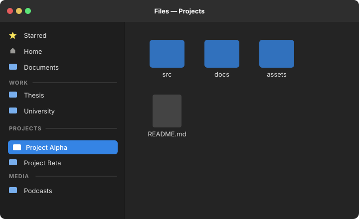

# Nautilus Sidebar Separators

[](LICENSE)
[](#requirements)
[](#requirements)
[](#requirements)

Organize your Nautilus sidebar bookmarks with customizable section headers and horizontal dividers with native drag & drop reordering.



---

## Quick Installation

### One-line Install

Run the following command in your terminal:

```bash
curl -fsSL https://raw.githubusercontent.com/marchacio/nautilus-sidebar-separators/main/install.sh | bash
```

### Manual Installation

Clone the repository and run the installer:

```bash
git clone https://github.com/marchacio/nautilus-sidebar-separators.git
cd nautilus-sidebar-separators
./install.sh
```

The installer will:
1. Detect your package manager and ensure `nautilus-python` is installed.
2. Copy `src/sidebar_separators.py` to `~/.local/share/nautilus-python/extensions/`.
3. Create `~/.local/share/nautilus-separators/` for separator dummy directories.
4. Install the `nautilus-separator` CLI tool into `~/.local/bin/`.
5. Restart Nautilus via `nautilus -q` to activate the extension.

---

## Usage

### Using the CLI (`nautilus-separator`)

The included command-line tool makes managing sidebar sections effortless:

#### 1. Add a separator header
```bash
nautilus-separator add "WORK"
nautilus-separator add "PROJECTS"
nautilus-separator add "PERSONAL"
```

#### 2. List all configured separators
```bash
nautilus-separator list
```
*Output:*
```text
Configured Nautilus Sidebar Separators:
────────────────────────────────────────────────────────────────────
#    NAME                   SLUG               STATUS      
────────────────────────────────────────────────────────────────────
1    WORK                   work               ✔ valid     
2    PROJECTS               projects           ✔ valid     
3    PERSONAL               personal           ✔ valid     
────────────────────────────────────────────────────────────────────
Total: 3 separator(s). You can drag them directly inside Nautilus sidebar.
```

#### 3. Remove a separator
```bash
nautilus-separator remove "WORK"
# or remove by slug:
nautilus-separator remove work
```

#### 4. Clean all separators
```bash
nautilus-separator clean
```

#### 5. Restart Nautilus
```bash
nautilus-separator restart
```


## Uninstall

To completely remove the extension, CLI utility, dummy folders, and separator bookmarks:

```bash
./uninstall.sh
```

Or manually:
```bash
rm -f ~/.local/share/nautilus-python/extensions/sidebar_separators.py
rm -f ~/.local/bin/nautilus-separator
rm -rf ~/.local/share/nautilus-separators
# Remove lines containing 'nautilus-separators' or '# ' from ~/.config/gtk-3.0/bookmarks
nautilus -q
```

---

## Contributing

Contributions, bug reports, and suggestions are warmly welcome!
1. Fork the repository.
2. Create a feature branch (`git checkout -b feature/my-feature`).
3. Run the unit tests (`python3 -m unittest discover -s tests`).
4. Commit your changes and open a Pull Request.

---

## License

This project is licensed under the [MIT License](LICENSE).

All the code was developed by [Marchacio](https://github.com/marchacio) using Antigravity CLI and is free to use, modify, and distribute under the terms of the MIT License.
